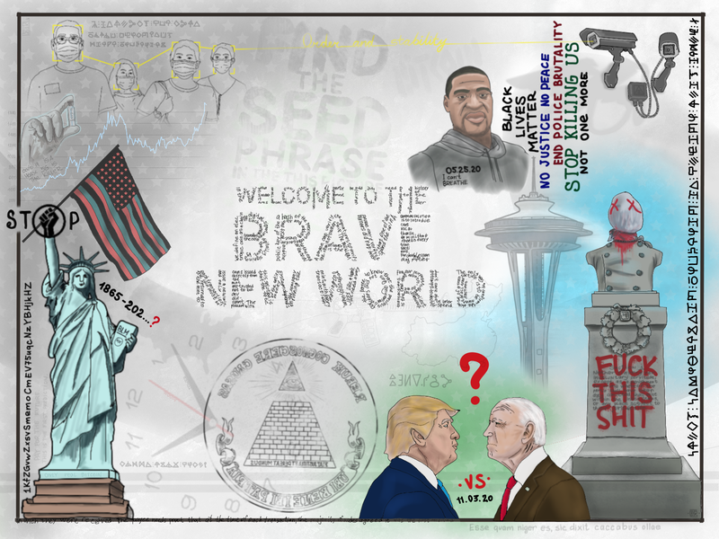
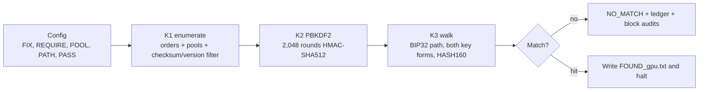

# The 0.2 BTC "Brave New World" Puzzle: Engine, Ledger, and Exclusions

> **Looking for a basic clue-by-clue walkthrough?** Start with [HomelessPhD's write-up](https://github.com/HomelessPhD/BLM_0.2BTC), [rarsn4's analysis](https://github.com/rarsn4/blm-0.2btc-analysis), or [panchpasha's script](https://github.com/panchpasha/0.2-BTC-Puzzle-script). This repository assumes familiarity with the picture and focuses on reproducible verification, search tooling, measured image data, and what is already ruled out.

This repository is the public technical record for one systematic effort on the October 2020 Bitcoin picture puzzle (`1KfZGvwZxsvSmemoCmEV75uqcNzYBHjkHZ`). **It contains no solution.**

What this repository provides:

- **A verified, read-only GPU search engine** ([`gpu_setperm.py`](puzzles/btc-02-picture/harness/gpu_setperm.py), engine hash `9cb088b6d185f485`) for BIP39, Electrum v2 (12/13-word), and raw no-checksum (`bip39raw`) spaces, running a register-resident PBKDF2-HMAC-SHA512 OpenCL kernel (~94% of hashcat class on Blackwell), backed by 383 unit/parity tests and CPU reference solvers.
- **A reproducible run ledger and config archive** ([`ledger/runs.jsonl`](puzzles/btc-02-picture/ledger/runs.jsonl), [`harness/templates/`](puzzles/btc-02-picture/harness/templates/)) up to the **2026-10-02 07:12** export cutoff (`718` verified `NO_MATCH` runs, `1.48 × 10¹²` candidates tested), along with independent audit reports ([`lanes/`](puzzles/btc-02-picture/lanes/)) and a `SHA-256` manifest.
- **A current exclusion summary through 2026-11-17** covering post-cutoff GPU, CPU, and image-forensic sweeps (`3,899` verified home-card GPU `NO_MATCH` runs totaling `20.65 × 10¹²` candidates, plus rented GPU batches, `0` hits), plus measured corrections so compute is not wasted repeating closed searches or debunked readings.

## Target and chain facts

| Item | Verified value |
|---|---|
| Address | `1KfZGvwZxsvSmemoCmEV75uqcNzYBHjkHZ` (legacy P2PKH, version `00`, HASH160 `ccbd031e54cde2a3189fd59bc49f731367a1779e`; verify via `python3 tools/check_target.py`) |
| Balance | `20,107,284 sat` across 5 UTXOs; never spent, public key never exposed |
| Funding tx | [`fcee21d4…d043`](https://mempool.space/tx/fcee21d44ee94c09869947c74b61669bf928358e9c2d1699fb075bb6ebf5d043) on `2020-05-10 08:01 UTC`: exact `0.2 BTC` from 4 nested-segwit (P2SH-P2WPKH) inputs, change to P2SH. Remaining `107,284 sat` are 4 stranger deposits (2023 to 2025) |
| Funder fingerprint | Version 1, no RBF, BIP69 ordering, `3 sat/vB` fee reproducing the 2020 Trezor web wallet size table (compatible with Trezor, not proof; one HD seed can hold both funding and prize accounts) |
| Reddit post | `u/stsh_n`, `2020-10-08 09:25 UTC`, "Bitcoin puzzle (2000$)", image only, single post, no comments or hints since [1] |
| Canonical image | [`puzzles/btc-02-picture/artifacts/puzzle.png`](puzzles/btc-02-picture/artifacts/puzzle.png): `1600 × 1200` RGBA PNG, `2,383,395` bytes, sha256 `d0b04378f75d63997b8034ec2ef1bdd108178e4546de78237bd35abf4189a782`. Byte-identical across Reddit and mirrors; clean PNG chunks, no trailing bytes, opaque alpha, paper-grain LSBs |
| Chronology constraint | Funded `2020-05-10`, predating `05.25.20` (George Floyd) and `11.03.20` (US election). The seed existed first and the artwork was drawn around it; thematic scene words carry no selective weight over random nouns |



## Candidate models and wallet constraints

The only instruction in the artwork is `FIND THE SEED PHRASE IN THE THIS PICTURE`. Because the prize address has never spent, searches must test plausible 2020 formats, paths, and key forms:

| Model / Format | Structure | Where `MOON` goes | Notes |
|---|---|---|---|
| **P** (BIP39 12w) | 12 BIP39 English words (`2,048^12`, `1/16` checksum pass) + passphrase | Passphrase (`MOON`, `moon`, `Moon`, or empty) | Standard path `m/44'/0'/0'/0/0` verified against Trezor test vectors |
| **E12** (Electrum v2 12w) | 12 words, version prefix `01` (`1/256` pass, any dictionary) + extension | Extension (`moon` or empty) | Segwit and 2FA Electrum seeds cannot yield `1...` P2PKH addresses |
| **E13** (Electrum v2 13w) | 13 words, version prefix `01` | Word 13 (`moon`) | Matches the literal "13" clock reading without a passphrase |
| **Raw** (`bip39raw`) | Plain text, no checksum or word list enforced | Word or passphrase | Models Electrum 3.3.8 "BIP39 seed" import (`NFKD`, case kept, 16x/256x cost of BIP39/Electrum) |

- **Paths tested across the record:** BIP39 `m/44'/0'/0'/0/{0,1,10}`, `m/0'/0/0`, `m/0/0`; Electrum `m/0/{0,1,2}`, `m/1/0`; extended receive/change/account sweeps on tight shapes. Both **compressed and uncompressed** P2PKH keys are derived on every GPU run.
- **2020 wallet check:** Electrum v2 never pays to the master node `m` (always `m/0/i`); old Electrum 1.x lacks 5 of the 12 core device words (`~1.1B` old-Electrum candidates still ran `NO_MATCH`).

## Measured picture data and frames

Pixel coordinates are `(x, y)` in original `1600 × 1200` `puzzle.png` pixels. Full-resolution crops and contrast renders are under [`puzzles/btc-02-picture/artifacts/`](puzzles/btc-02-picture/artifacts/).

### 1. Slot table and device-backed words

Grades reflect the tie between word and slot: **A** written word + written/measured number (`A-` with one inferred link), **B** measured geometry + viewer object name, **W** count/theme reading.

| Slot | Word | Grade | Device / Measurement |
|---|---|---|---|
| 1 | `subject` | A | Underlined `1` of `Section 1` + underlined `subject` in 13th Amendment text |
| 3 | `tower` | A | `TOWER` painted along minute hand (`1.48` to `1.52`, between `1` and `2`, sum `3`) |
| 9 | `eye` | B | Seal capstone pupil at `(652.7, 847.8)`, clock dial `4.51` (midpoint `4\|5`, sum `9`) |
| 10 | `black` | A- | Right border Russian cipher ending `номер X` (`Nauthiz`-shaped stave = 10) + `"чёрный день"` ("black day") + Latin `"niger"` |
| 11 | `pyramid` | B | Seal outer ring centre at `(646.2, 946.9)`, clock dial `5.49` (midpoint `5\|6`, sum `11`) |
| 12 | `vote` | W | `.VS.` inverted as `12` + `11.03.20` election date (weak; `TUESDAY` sits above left profile) |
| 13 | `moon` | A | `MOON` painted along red second hand (`0.53`, between `12` and `1`, tail between `6` and `7`, both sum `13`) |
| 21 | (none) | B | Unlabelled hour hand (`10.45` to `10.49`, between `10` and `11`, sum `21`); red dotted line has `21` dots |

Five additional words are singled out by explicit devices without a slot number: **`food`** (painted down the Space Needle shaft at dial `4.73`, between `4` and `5`), **`this`** (extra word in `IN THE THIS PICTURE`), **`real`** (lowercase in `ONLY real BITCOIN`), **`one`** (lowercase `e` in `NOT ONe MORE`), and **`order`** (yellow cursive `Order and stability`, also where the whitepaper micro-text cuts off).

Slots `2, 4, 5, 6, 7, 8` have only weak count/theme guesses (`camera`, `mask`, `police`, `liberty`) or are blank (`6, 8`). Nothing writes `14, 15, 18, 22, 23, 24` (`16` rifle, `17` gold chart years, `19` CVD19, `20` circled `XX` are weak). A 24-word phrase leaves at least 13 slots unpinned.

**Alternative frame, Cone order (2026-11-03):** Placing a 12-hour dial hub beside the Space Needle (`~1094, 648`) puts the 12 core words into slices: `one black _ food subject _ vote pyramid eye this order _` (slots `3, 6, 12` empty; `TOWER`, `MOON`, `REAL` share `EYE`'s slice).

### 2. Verified transcriptions and geometry

- **Clock (`hub 472.0, 940.2`, radius `~183 px`, turned `-72.5°`):** Hand residuals `<= 1.1 px`. An hour hand at `10.45` corresponds to `~10:27`, placing a real minute hand at `5.4`, not `1.5`. The hands do not show a time.
- **Russian substitution cipher (28 glyphs, 1:1):**
  - Right border (bottom to top): `Здесь зашифрованы биткоины на чёрный день номер X` ("Here are encrypted bitcoins for a rainy [lit. black] day, number X")
  - Top border: `Я надеюсь, что сюда будут присылать много биткоинов` ("I hope that many bitcoins will be sent here")
  - Clock dial strip: `СУММА ДВУХ ЧИСЕЛ` ("Sum of two numbers")
- **Bill Cipher row (above Trump):** `TUESDAY` (7/7 under the public Bill Cipher chart; distinct from the Russian key).
- **Mirrored Great Seal:** `RERUM COGNOSCERE CAUSAS`, `FIAT JUSTITIA ET PEREAT MUNDUS`, `UBI BENE IBI PATRIA` (all text reversed).
- **Whitepaper micro-text:** Section 2 of the Bitcoin whitepaper inside `WELCOME TO THE BRAVE NEW WORLD` (order: `BRAVE, NEW, WORLD, WELCOME, TO, THE`) continuing along the bottom border, breaking off at `order`, with 10 deviations (`introdue`, `doudle`, `sing`, `abcense`, `participans`, `wich`, `proot`, `transactian`, deleted `a trusted`, `oder`).
- **Other text quirks:** `PAY FOR THE FUTURE. THIS IS THE FIRST PREDICTION` (faint under address); `L U N` block capitals in `involuntary`; seven slogan lines indented so one column spells `BITCOIN` (`0.36%` by chance); Latin bottom proverb `Esse quam niger es, sic dixit caccabus ollae`; `CHaRLy` / `-CHR-` signatures.

## Withdrawn claims and debunked readings

Measured checks (through `2026-11-17`) overturned the following recurring claims:

| Claim | Measured fact |
|---|---|
| Clock shows `10:07` | Hands sit on numeral midpoints (`0.53`, `1.52`, `10.45`); ~10° off any valid clock time |
| Seal is opaque | Dial numerals `4`, `6`, `7` show faintly through the seal paint (`5` does not) |
| `THIS` in header is tinted green | Green on `S` is a dot from the speckled background form behind it (`2026-11-12`) |
| `MOON`, `TOWER`, `FOOD` are pencil/graphite | Each is in its own hand/shaft paint; `MOON`/`TOWER` lie directly on hand axes (`0.2`/`0.8 px`, `2026-11-12/13`) |
| `NOT one MORE` | Only the `e` is lowercase: `NOT ONe MORE` |
| Seven drawn rays on Liberty's crown | Six are drawn; the seventh would sit behind the raised arm |
| Bill Cipher row reads `TUESVAP` | Reads `TUESDAY` (7/7 glyphs) |
| 11 whitepaper edits (`must be` deleted) | 10 edits; `must be` is present inside the `N` of `NEW` |
| `1713` near COVID sign / `end12` on vial | Misread `19 IS` and inverted `CVD19` |
| Bust `X` eyes / swear graffiti are clues | Copied verbatim from the 2020 source painting of a defaced New Orleans monument |
| Faint mark near slanted `BITCOIN` is a hidden letter | Ordinary paper grain (68th percentile of empty ground patches, `2026-11-12`) |
| `0.201 BTC` balance means `2 of 10` | Author sent exact `0.2 BTC`; `107,284 sat` are later stranger deposits |
| Space Needle aligns with seal slot 11 | `FOOD` ink centroid sits at dial `4.73` (`4\|5`), not `5\|6` |
| List-number sums in picture words are signal | Six `a + b = c` sums across 32 BIP39 words occur ~1 in 6 by chance (`2026-11-12`) |
| Steganography / CLIP / Atlanta painter | No PNG/LSB/OpenStego/stegpy/cloacked-pixel/FFT payload; CLIP ranks core words at chance (`p = 0.14`); Charly Palmer link unsubstantiated |

## What has been tested

- **In this repository's reproducible ledger (cutoff `2026-10-02 07:12`):** `718` verified GPU `NO_MATCH` runs (`716` distinct signatures), `1,479,268,494,119` (`1.48 × 10¹²`) tested, `17,799,496,608` valid, `1,013,496` planted seeds found, `0` hits. Full breakdown in [TESTED.md](TESTED.md).
- **Full working record through `2026-11-17` (beyond the published snapshot):** `3,899` verified home-card GPU `NO_MATCH` runs (`20,646,944,488,532` tested, `230,264,856,616` valid, `0` VOID, `0` FOUND), plus rented L4 and 4× RTX 4090 batches (`4,100+` finished GPU runs across `13,425` drafted configs).

### Summary of closed spaces (to 2026-11-17, all NO MATCH)

| Family | What ran | What it does NOT exclude |
|---|---|---|
| **One-open full list (tight)** | All 3 models (`E13`, `E12`, `P`) + `black` free, `vote` free, `moon@1`, numeral words, `eye` as 13/passphrase/free, `this`/`section`@1, extended paths | 2+ unknown words; wrong core pins |
| **Two-open full list (`2,048²`)** | `subject@1 tower@3 eye@9 pyramid@11` held, 5 marked words required, any 2 words over full BIP39 list (`E13`, `E12`, `P` with `black@10` and `black` across all free slots, `MOON`/`moon`/`Moon`/empty) | 3+ unknown words (`~170 GPU-days` in `P` on 1× 5060 Ti); other passphrases |
| **Dropped / swapped pins** | Leave-one-out on all 5 floaters and pinned words; `subject`/`tower` dropped (`E13`, `E12`, `P`); all 15 two-pins-wrong pairs across 3 orders (`P`, `E12`, `raw`: `135` configs); `eye/pyramid/vote` dropped + 15-word pool (`E12`, `BIP39 A`); `9`/`11` open (`266` pairs, motto words, `E13`/`E12` single-open, `79`-word picture pool) | `9` and `11` both over full 2,048 list (`26 h` E13, `2 d` E12, `2 mo` P); `BIP39 B` 3-pin drop (`305 h`); `E13` two-pins-wrong |
| **Cone order** | Slots `3, 6, 12` open over full 2,048 BIP39 list (`536.9M` valid × empty/`bitcoin`/`BiTCOIN`/`MOON`/`moon`/`Moon`); Electrum, raw, `coin@12`, `liberty@12`, `blue` variants | Three-open raw (`~31 h`) |
| **Clock & Twin-dial seal** | All `2,816` clock readings / `280` placements (`840` GPU configs); `27` moved hubs (`32` configs); twin-dial seal (`219` GPU configs + `6M` CPU); `99` + `78` seal Latin motto passphrases | Readings with a newly discovered label |
| **Hollow letters & Core 12** | `WELCOME TO THE` micro-text words (`231` GPU configs); core 12 in every order (`P`, `E12`, `raw` with main passphrases); `103.8M` BIP39 list-sorted subsets of 29 written words | Raw every-order with unlisted passphrases |
| **Alternative formats & lengths** | `152` raw runs (`29` cheapest twins on CPU); old Electrum 1.x (`~1.1B` phrases across 9 families); 8 non-English BIP39 lists (tight CPU); BIP39-15 (`13`-word & 6-pin probes, `15`-word visual groups); `18/21/24`-word community tables; `34,545` BIP39 / `29,200` Electrum free-string seeds; `11` solved-puzzle conventions | Full-list 15/24-word spaces; `399` held raw twins (`~1,866 h`); non-P2PKH address types |
| **Passphrases & Ciphers** | `1,318` tier-0 + `818` tier-1 strings, `55` date forms, `26,239` brainwallets, `6,059` vowel-swapped strings, Russian border clauses (`237` runs), flag-colour slogans, `17` Elder Futhark rune-name configs (`4.06B`), cipher numbers as keys/entropy | Unlisted passphrases over full 1-open/2-open spaces; trailing-space passphrases |
| **Image & Keyed Stego** | Container/alpha/LSB, noise/chroma/resampling/copy-move/TruFor, OCR, 4 object detectors, 2 VLMs, CLIP (`2,048` words), whole-image FFT, `181,330` passphrases (`489,870` encodings) against OpenStego random/plain, stegpy, and cloacked-pixel | Tools outside tested set (OpenPuff, SilentEye); passwords outside `181,330` list |

## The GPU engine

[`puzzles/btc-02-picture/harness/gpu_setperm.py`](puzzles/btc-02-picture/harness/gpu_setperm.py) parses a declarative search config (`SCHEME`, `WORDS`, `FIX`, `REQUIRE`, `POOL`, `PATH`, `PASS`), enumerates candidate index spaces on GPU, filters checksums/versions, runs PBKDF2 and BIP32 on GPU, and compares only `HASH160` targets.



### Benchmarks (RTX 5060 Ti, 36 SMs)

| Stage / Pipeline | Measured rate | Notes |
|---|---|---|
| K1 (enumeration + BIP39 checksum) | `3.75 G candidates/s` | Electrum version filter: `687 M/s` |
| K2 (`sp_pbkdf2.cl`, register-resident) | **`426k seeds/s`** | Replaces `149.5k/s` byte-array kernel; **~94% of hashcat v7.0.0 class** (scaled from RTX 5070 [13]) |
| K3 (`m/44'/0'/0'/0/0` + P2PKH) | `2.36 M derivations/s` | Fixed-base secp256k1 mul + serialise: `10.05 M/s` |
| Whole pipeline (BIP39 12w, 1 / 5 paths) | `381k / 269k derivations/s` | Electrum 12w (1/4/8 paths): `341k / 285k / 260k`; 13w (4 paths): `255k` |

Each SHA-512 compression compiles to ~3,460 instructions (3,384 integer ops), making K2 instruction-issue bound. A custom CUDA port agrees within 1%, and modelling halved walk overhead + CPU side-lane yields `1.25x` to `1.66x` total speedup. Compute rate is not the bottleneck; clue selection is.

### Trust model and audits

- **Known-answer suite:** `gpu_setperm_test.py` runs `383` tests (`115` GPU) against `hashlib` and an independent CPU reference ([`sp_ref.py`](puzzles/btc-02-picture/harness/sp_ref.py)), covering BIP39 vectors, 12 to 24 words, passphrases, and 128-byte HMAC key boundaries.
- **Per-run & per-block controls:** Every run executes a combo self-test, slot sweep, and 66-slot target reach before block 0. Every block plants **64 deterministic test seeds** and duplicates the real prize target across **2 rotating slots** (`(1 - q)^64` escape bound), enforces exact 64-bit index sums (`tested == scanned`), checks survivor counts (8-sigma binomial bound, or exact `survivors == tested` for `bip39raw`), and runs a per-block CPU window audit (`<= 32,768` candidates).
- **Independent reviews ([`lanes/`](puzzles/btc-02-picture/lanes/)):** Fault injection (9/10 injected faults caught as `VOID`, leading to 64 plants + dual prize slots), independent config decoder across `461` configs (`33,804` derivations, `0` mismatches), Electrum 3.3.8 parser verification (`1.11M` code points, `45/49` mutants killed, `4` unreachable), and [`harness/ledger_recon.py`](puzzles/btc-02-picture/harness/ledger_recon.py).

## Quickstart and verification

### CPU-only verification (Python 3 stdlib)

```bash
python3 tools/check_target.py       # verify target HASH160 ccbd031e...
python3 tools/tally.py              # recompute ledger totals (matches expected_output/tally.txt)
python3 tools/tally.py --windows    # recompute window table of TESTED.md
sha256sum -c MANIFEST.sha256        # verify repository integrity
```

### GPU engine setup and test suite

The engine uses 14 third-party OpenCL kernels from `johncantrell97/bip39-solver-gpu` [15] (unlicensed upstream, so fetched rather than redistributed; pinned by SHA-256 in [`UPSTREAM.sha256`](puzzles/btc-02-picture/harness/kernels/UPSTREAM.sha256)). The project's own `sp_*.cl` kernels share zero lines of 30+ characters with upstream ([THIRD-PARTY.md](THIRD-PARTY.md)).

```bash
python3 tools/fetch_kernels.py
cd puzzles/btc-02-picture/harness
uv run --no-project --python 3.12 --with coincurve --with numpy --with pyopencl python -c "import gpu_setperm as g; print(g.engine_hash())"   # 9cb088b6d185f485
SP_NO_GPU=1 uv run --no-project --python 3.12 --with coincurve --with numpy --with pyopencl python gpu_setperm_test.py   # Ran 383 tests ... OK (skipped=115)
uv run --no-project --python 3.12 --with coincurve --with numpy --with pyopencl python gpu_setperm.py templates/e4_pins_only.conf --dry-run
uv run --no-project --python 3.12 --with coincurve --with numpy --with pyopencl python gpu_setperm.py templates/e4_pins_only.conf --bench
```

Real searches require `--checkpoint` and `--signoff "..."`. The engine never builds or broadcasts transactions ([`docs/ADR-0001.md`](docs/ADR-0001.md)); on a hit it writes `FOUND_gpu.txt` and exits. Two earlier pre-hardening engine eras in the ledger (`4e905055f3f5fdaf`, `e9afbdfd40803095`) are excluded from this repository.

## Repository layout and scope

| Path | Contents |
|---|---|
| [`TESTED.md`](TESTED.md) | Detailed family-by-family exclusion tables for the `2026-10-02` published ledger |
| [`tools/`](tools/) | `tally.py`, `check_target.py`, `fetch_kernels.py` |
| [`expected_output/`](expected_output/) | Expected hashes, test output, target decode, and ledger tallies |
| [`docs/ADR-0001.md`](docs/ADR-0001.md) | Read-only, no-transaction contract and candidate-key protocol |
| [`puzzles/btc-02-picture/harness/`](puzzles/btc-02-picture/harness/) | `gpu_setperm.py`, `sp_*.py`, `kernels/sp_*.cl`, CPU solvers, tests, and `136` committed `.conf` templates |
| [`puzzles/btc-02-picture/ledger/`](puzzles/btc-02-picture/ledger/) | `runs.jsonl` (`1,447` records through `2026-10-02`) and queue logs |
| [`puzzles/btc-02-picture/lanes/`](puzzles/btc-02-picture/lanes/) | Independent engine review and audit reports |
| [`puzzles/btc-02-picture/artifacts/`](puzzles/btc-02-picture/artifacts/) | `puzzle.png`, contrast-enhanced clock/rune crops, README crops, and test vectors |
| [`PUBLICATION.md`](PUBLICATION.md), [`THIRD-PARTY.md`](THIRD-PARTY.md) | Sanitization log and third-party attribution/licensing notes |

**Not published here:** post-cutoff run logs and templates (`2026-10-03` onward), unrun/held configs and ranking scripts, open hypothesis queues, working reports, and the private CUDA ceiling-test prototype.

## Provenance and references

Working record compiled with AI coding agents; code is MIT ([LICENSE](LICENSE)), text/data CC BY 4.0 ([LICENSE-DATA](LICENSE-DATA)), `puzzle.png` belongs to its creator ([THIRD-PARTY.md](THIRD-PARTY.md)).

1. `u/stsh_n`, "Bitcoin puzzle (2000$)", 2020-10-08: <https://www.reddit.com/user/stsh_n/comments/j79zvj/bitcoin_puzzle_2000/>
2. `r/bitcoinpuzzles` thread: <https://www.reddit.com/r/bitcoinpuzzles/comments/jrr7mo/is_this_puzzle_still_valid_is_this_image_correct/>
3. `r/CryptoPuzzlers` thread: <https://www.reddit.com/r/CryptoPuzzlers/comments/mbdogq/02_btc_puzzle/>
4. Bitcointalk thread: <https://bitcointalk.org/index.php?topic=5404767.0>
5. privatekeys.pw entry: <https://privatekeys.pw/puzzles/0.2-btc-puzzle>
6. Address on mempool.space: <https://mempool.space/address/1KfZGvwZxsvSmemoCmEV75uqcNzYBHjkHZ>
7. Funding tx on mempool.space: <https://mempool.space/tx/fcee21d44ee94c09869947c74b61669bf928358e9c2d1699fb075bb6ebf5d043>
8. HomelessPhD, `BLM_0.2BTC`: <https://github.com/HomelessPhD/BLM_0.2BTC>
9. rarsn4, `blm-0.2btc-analysis`: <https://github.com/rarsn4/blm-0.2btc-analysis>
10. panchpasha, `0.2-BTC-Puzzle-script`: <https://github.com/panchpasha/0.2-BTC-Puzzle-script>
11. BIP-0039 / BIP-0044: <https://github.com/bitcoin/bips/blob/master/bip-0039.mediawiki>, <https://github.com/bitcoin/bips/blob/master/bip-0044.mediawiki>
12. Electrum seed format: <https://electrum.readthedocs.io/en/latest/seedphrase.html>
13. hashcat v7.0.0 RTX 5070 benchmark: <https://hashcat.net/forum/thread-13327.html>
14. Bitcoin whitepaper: <https://bitcoin.org/bitcoin.pdf>
15. `johncantrell97/bip39-solver-gpu`: <https://github.com/johncantrell97/bip39-solver-gpu>

*Ledger files reflect the `2026-10-02 07:12` cutoff; post-cutoff coverage and withdrawn claims reflect the working record as of `2026-11-17`.*

## Support and contact

Questions, corrections, or a lead backed by a new device/slot: open an issue or reach out on Reddit at [u/Desalzes_](https://www.reddit.com/user/Desalzes_/).

Optional tip addresses if this tooling or exclusion record saved compute:

- **BTC:** `bc1qptzpgk0z33nku9xrh8duay4jgt654uh65cc9rr`
- **ETH:** `0xd2C2408E370293aC7ac116512C1c57071B9FA5B6`
