# The 0.2 BTC "Brave New World" puzzle: what we know so far

Target: [`1KfZGvwZxsvSmemoCmEV75uqcNzYBHjkHZ`](https://mempool.space/address/1KfZGvwZxsvSmemoCmEV75uqcNzYBHjkHZ) · still unsolved. The prize (20,107,284 sat in 5 outputs) has never been spent; read from the chain on 2026-10-21.

**New to the puzzle?** This repository is dense and was made for people who have been working on it.
If you are new, start with these and come back: [HomelessPhD's write-up](https://github.com/HomelessPhD/BLM_0.2BTC),
[rarsn4's analysis](https://github.com/rarsn4/blm-0.2btc-analysis) and
[panchpasha's script](https://github.com/panchpasha/0.2-BTC-Puzzle-script).

This is one picture, posted to Reddit in October 2020 with no words at all [1], and a funded address
written down its left edge. The community has read it as a seed-phrase puzzle ever since [2, 3, 4, 5].
This repository is a working record of our attempt: the readings of the picture, the GPU code that
turned those readings into searches, and the log of every search, so that a "NO MATCH" can be checked
and not just believed. It contains **no solution**. The published ledger stops at **2026-10-02 07:12** (local
time); the page itself is written as of 21 October 2026 and says where it goes past the ledger.

The shape of this page follows HomelessPhD's write-up of the same puzzle [8], which is the best public
starting point: one section per clue, with the crop, what is written on it, what it refers to and what
has been tried. A few things are deliberately not published; they are listed near the end.

**[What was tested (TESTED.md)](TESTED.md):** 718 verified GPU runs, 1.48 × 10¹² candidates
(1,479,268,494,119), every finished run NO MATCH, with what each family of runs excludes and what it does not.
The figures are recomputed from the run ledger by `python3 tools/tally.py`.

## Summary

- **The picture pins words to slots, and the pins are real.** Three tiny hand-written labels (MOON and
  TOWER along two clock hands, FOOD on the Space Needle), a mirrored Great Seal placed on the clock
  face, an underlined "Section 1", a Russian sentence in a home-made rune alphabet and a handful of
  case and colour tricks give eleven device-backed words and six slot numbers
  ([the pins](#the-pins-slot-by-slot)). Every one of them has now been searched with one and two
  unknown words over the whole BIP39 list, in three seed formats, and nothing matched.
- **The clock is not a time.** Its three hands sit on the midpoints between numerals, and the dial
  strip says "sum of two numbers" in the rune cipher. MOON's hand reads 13, TOWER's reads 3, the
  unlabelled hour hand reads 21 ([clue 2](#2-the-clock)).
- **"Number 13" has two readings and both are closed at every bounded setting:** a 13-word Electrum
  seed with MOON as word 13, and a 12-word BIP39 seed with MOON as the passphrase
  ([the three models](#what-a-solver-has-to-guess)).
- **The wallet was funded before the events the picture shows.** 2020-05-10 against George Floyd's
  death on 05-25 and an election in November. So the words were chosen first and the scenes drawn
  around them, which is why thematic words (police, justice, vote) carry little weight and words with
  an explicit hiding device carry most of it ([timeline](#timeline)).
- **The engine is at the hardware's ceiling for this job.** Its PBKDF2 kernel runs at about 94 % of
  hashcat's class on the same GPU generation, and a purpose-built engine models to 1.3x to 1.7x, not
  more ([the engine](#the-gpu-engine)).
- **What would change the picture:** a word from the author, a new device-backed word, or a reading
  that pins a slot above 13. Compute alone has stopped being the lever.

## The puzzle

### The address and the funding

| Fact | Value |
|---|---|
| Address | `1KfZGvwZxsvSmemoCmEV75uqcNzYBHjkHZ`, legacy P2PKH (version 00, HASH160 `ccbd031e54cde2a3189fd59bc49f731367a1779e`); `python3 tools/check_target.py` decodes it |
| Balance | 20,107,284 sat in 5 outputs, nothing spent, public key never exposed, so only the seed recovers it |
| Funding | [`fcee21d4…d043`](https://mempool.space/tx/fcee21d44ee94c09869947c74b61669bf928358e9c2d1699fb075bb6ebf5d043), 2020-05-10 08:01 UTC: exactly 0.2 BTC from four nested-segwit inputs, change to a P2SH address. The other 107,284 sat are four later deposits from strangers (2023 to 2025) |
| The funder's wallet | version 1, no RBF, BIP69 ordering, a 3 sat/vB fee that reproduces exactly with the 2020 Trezor web wallet's size table; compatible with a Trezor, not proven. One seed can hold both the funding account and the prize account, so this says nothing about how the prize mnemonic was made |
| Posted | Reddit u/stsh_n, 2020-10-08 09:25 UTC, title "Bitcoin puzzle (2000$)", image only, one post ever, no comment, no hint since [1] |
| The picture | `puzzles/btc-02-picture/artifacts/puzzle.png`, 1600 x 1200, 2,383,395 bytes, sha256 `d0b04378f75d63997b8034ec2ef1bdd108178e4546de78237bd35abf4189a782`. The Reddit original and every mirror we checked are byte-identical; no larger version exists anywhere we could reach. AI super-resolution is banned here: it invents glyphs |
| The author | unknown. A "CHaRLy" signature and a "-CHR-" monogram are in the corners ([clue 17](#17-the-signature)). Community guesses (an Atlanta painter, a French street artist) are unverified and we record neither as the creator |

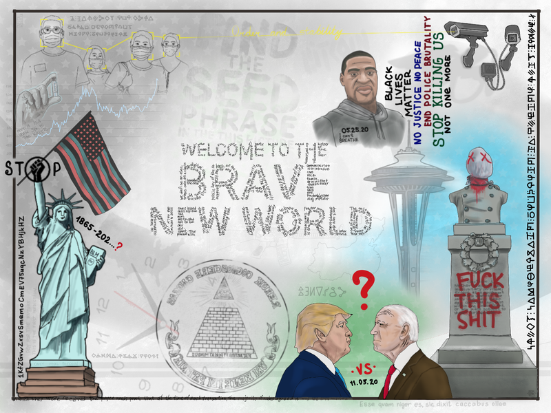

### What a solver has to guess

The community standard, and the one our verifier reproduces against the Trezor test vector, is **12 BIP39
words to `m/44'/0'/0'/0/0` to a legacy address** [11]. A BIP39 phrase has 2,048 possible words at each slot,
a checksum in the last word (1 in 16 twelve-word phrases are valid), and an optional passphrase that
changes the key entirely. Electrum's own seed format [12] (12 or 13 words, a version prefix instead of a
checksum, any dictionary) is the other live candidate, because two of the picture's readings need a
thirteenth element. So a search has to fix:

1. **Which words.** The picture's device words, plus unknowns taken from the whole list or from pools.
2. **Their order.** Six slots are pinned by the picture; the rest float.
3. **The format.** We call the three that survive the picture's "13" reading the three models:
   **E13** (Electrum, 13 words, moon the 13th), **E12** (Electrum, 12 words, extension "moon") and
   **P** (BIP39, 12 words, passphrase MOON, moon or Moon). The empty passphrase is always tried too.
4. **The path and key form.** BIP44 account 0, receive 0 first; then `m/44'/0'/0'/0/{1,10}`, `m/0'/0/0`,
   `m/0/0`, Electrum's `m/0/{0,1,2}` and `m/1/0`, and on the tight shapes many more receive, change and
   account indices. Compressed and uncompressed keys are both derived.

A 12-word phrase with eleven words known and their order fixed has 2,048 candidates. With one unknown
word and six free positions it has 6! x 2,048 = 1,474,560. With two unknown words over the whole list,
10.6 billion; three, about 170 GPU-days on our card. That arithmetic is the whole story of what could
and could not be searched.

## Timeline

Every search in this table ended NO MATCH; the rows say what was run and when.

| When | What happened |
|---|---|
| 2020-05-10 | The address is funded with 0.2 BTC. |
| 2020-05-25 to June | George Floyd is killed (the picture shows "05.25.20"); statues are defaced across Europe and the US. |
| 2020-10-08 | u/stsh_n posts the picture [1]. The r/bitcoinpuzzles repost [2] and a bitcointalk thread follow within weeks. |
| 2021 | The community decodes the Russian rune sentences and the Bill Cipher line; the r/CryptoPuzzlers thread opens [3]. |
| 2022-07 | bitcointalk topic 5404767 opens [4]; the 13-stripes passphrase and 44-stars BIP44 readings are posted there in 2023. |
| 2026-05-31 | The border cipher turns out to be a one-to-one substitution over Russian Cyrillic; the clock is confirmed as a real dial with labelled hands; a first GPU sweep (every order of a community set, ten passphrases). |
| 2026-06 | A month of image and source work (the June record), all negative. |
| 2026-09-22 | The re-orientation: the clock re-measured (three hands, all on numeral midpoints, 13 / 3 / 21), the device ledger, the positional ledger, the funding-date argument. |
| 2026-09-23 to 28 | Electrum-13 closed at one and two unknowns; model P and the clock-model battery closed; a GPU engine designed and written (K1 to K3). |
| 2026-09-29 | The engine's first day: E4 (84.6 billion candidates) in 21 minutes; an independent review injects faults and the engine is hardened (64 plants per block, the prize at two slots, a required sign-off). |
| 2026-09-30 to 10-02 | 718 runs in four days: the broad lead hunt, replacement readings, passphrase batteries, the raw-text scheme, two more audits. The published ledger ends here, at **2026-10-02 07:12**. |
| 2026-10-03 | This repository is published. |
| 2026-10-09 | Every reading of the clock we could enumerate (840 configs) is run and the clock closed; the first rented cards run a 53-tile batch of the widest shapes. |
| 2026-10-16 to 17 | Image forensics, an object inventory by hand and by detector, two local vision-language readers, key forms other than BIP39, solved-puzzle conventions: nothing new. The queue is rebuilt as one evidence-ranked registry. |
| 2026-10-17 to 19 | Two rented 4 x RTX 4090 boxes run 260 rows of the ranked queue. |
| 2026-10-21 | The engine's ceiling is measured against hashcat's class; the "misdirection" closures and a 24-word Trezor reading are run; the search is paused. |

## The numbers (as of 21 October 2026)

| Measure | Value |
|---|---|
| Published record (to 2026-10-02 07:12) | 718 verified GPU runs, 1.48 × 10¹² candidates enumerated (1,479,268,494,119); every finished run NO MATCH, here and in the rows below. `TESTED.md` has the valid and derived counts and the plants |
| Work since then, in the private ledger (to 2026-10-21) | 983 finished runs, 3.33 x 10¹² candidates, 30.7 billion checksum-valid and derived in full. Home cards only; the rented tiles and rows have their own row below. Not yet in this repository's ledger ([since the published record](#since-the-published-record)) |
| Before the ledger (May to September 2026) | the full 12! sweeps of three community sets x about ten passphrases, 65 CPU runs (15.1 billion candidates), June's sets |
| Rented compute | 53 tiles on two Lightning L4 studios (9 to 10 October), 126 and 134 rows on two 4 x RTX 4090 boxes on vast.ai (17 to 19 October) |
| The engine | 426k seeds/s on the PBKDF2 kernel alone, 255k to 381k derivations/s through the whole pipeline by scheme and path count, on one RTX 5060 Ti |
| The picture | 27 drawn objects in the hand register, 66 BIP39 names of depicted things, 11 device-backed words, 20 image investigations closed |
| Passphrases and extensions tried | a 1,318-string list and 818 more at tier 1, 55 date forms, the strings in the table below |
| Engine checks | 383 tests (115 need a GPU), five independent agent reviews and audits, 49 mutants (45 killed, the 4 survivors unreachable), a ledger reconciliation that matches every run to an unchanged config |

## The clues

Each section shows the crop (plain pixel copies of the original, made by
`artifacts/readme-crops-2026-10-21/make_crops.py`; the few zooms repeat pixels and add nothing), what is
written there, what it refers to, and what the record reads from it. "Tried" means a search was run with
that reading and finished NO MATCH; the families are in [TESTED.md](TESTED.md). Word lists in this part
are readings, not claims that a word is in the seed.

### 1. The borders: the address and the rune cipher

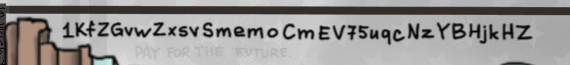

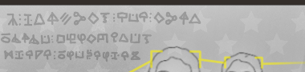

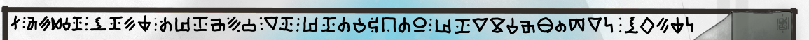

**Written:** the prize address along the left edge, written upward. Three rows of glyphs at the top left
and one long row down the right edge, in a hand-drawn alphabet that mixes Bill Cipher, Elder Futhark and
Cyrillic-looking shapes. A caption in the faint layer under the address reads "PAY FOR THE FUTURE. THIS IS
THE FIRST PREDICTION".

**What it is:** a one-to-one substitution cipher over **Russian**. We recovered eleven glyphs by crib on
2026-05-31 and a 19-glyph key in June; a key rebuilt from the right border and the clock strip alone
predicted every group length of the held-out top rows. The glyphs are about 47 px tall and legible after
binarisation; resolution was never the obstacle.

| Inscription | Plaintext | Translation |
|---|---|---|
| Right border | Здесь зашифрованы биткоины на чёрный день номер X | "Here are encrypted bitcoins for a rainy day, number X" |
| Top border | Я надеюсь, что сюда будут присылать много биткоинов | "I hope that many bitcoins will be sent here" |
| Clock dial strip | СУММА ДВУХ ЧИСЕЛ | "Sum of two numbers" |

**The number glyph.** The sign after "номер" ("number") is a full-height stave crossed by one diagonal:
the rune **Nauthiz**, the 10th rune of the Elder Futhark, which is how the community and we read
"number 10". "Чёрный день" is literally "black day" (idiomatically "a rainy day"), and the Latin proverb
along the bottom edge says "look how **black** you are" ([clue 16](#16-the-bottom-border)), so the record
pins **black @ 10** at medium confidence. The glyph does not force 10: it could be a Latin X, the
Church-Slavonic numeral for 10, or the rune's sound value N. Only the first two keep black at 10, and
black has also been searched absent and anywhere.

**Tried:** black @ 10 in every shape; black free; black absent; the Russian words of the sentences as
passphrases and as Electrum extensions; "ten", "there" (здесь can be read "there") and "need" (Nauthiz's
name) as words; the Elder Futhark route (17 configs that read the other glyphs as rune names); numerals
and brainwallets of all the decoded texts.

### 2. The clock

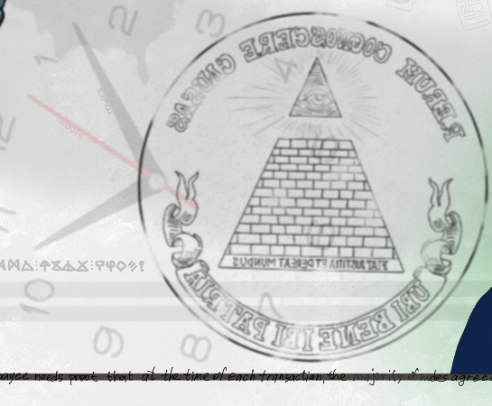

Contrast-enhanced renders from May: [the whole dial](puzzles/btc-02-picture/artifacts/clock/clock_full_ac.png),
[the two labelled hands](puzzles/btc-02-picture/artifacts/clock/hands_ul_hc.png) and
[the dial strip](puzzles/btc-02-picture/artifacts/clock/cipher_clean_ac.png).

**What it is:** a real clock face at the lower left, its dial turned about 73 degrees counter-clockwise
(numeral 12 sits near the left), its centre and right half covered by the mirrored Great Seal. The exposed
numerals are 2, 3 and 8 to 12. Three hands. Along the red second hand the word **MOON** is written in tiny
graphite letters; along the minute hand, **TOWER**; the hour hand carries nothing. The dial strip at about
nine o'clock is the rune text "sum of two numbers".

**Measured** (hands fitted from pixels, hub at (472.0, 940.2), residuals at most 1.1 px):

| Hand | Label | Sits between | Sum |
|---|---|---|---|
| second (red, with a tail) | MOON | 12 and 1 | **13** |
| minute | TOWER | 1 and 2 | **3** |
| hour | none | 10 and 11 | **21** |

It is not a time: a real hour hand for 7.6 minutes past would sit a tenth of the way from 10 to 11, and
this one sits at 0.45, nearly ten degrees off. MOON's hand is the only one with a tail, and the tail points
at 6 and 7, which also sum to 13. Of the readings we could define (literal sum, mod 12, 12 as 0, a 24-hour
ring, lower numeral, upper numeral), only the literal sum gives MOON's hand the same number from both ends
and avoids colliding with "Section 1".

**Tried:** tower @ 3 and moon @ 13 (as Electrum's 13th word and as the BIP39 passphrase) in every shape;
moon @ 1, @ 2, @ 12 and as a plain word; the hour hand's 21 as a word count, a slot and "21000000"; every
placement rule we could enumerate for the three hands (2,816 readings, 280 placements, 840 configs,
on 2026-10-09); the rotated dial; the hour hand as a pointer to the strip; the clock as a compass
bearing (chance-level).

### 3. The Great Seal, mirrored


**Written:** three Latin mottoes in place of the real seal's: RERUM COGNOSCERE CAUSAS round the top
(Virgil: "to know the causes of things"), FIAT JUSTITIA ET PEREAT MUNDUS across the base ("let justice be
done though the world perish"), UBI BENE IBI PATRIA on the banner ("where it is well, there is the
homeland"). All lettering is reversed: the seal is drawn mirrored. The pyramid has 13 brick courses, as the
real one does.

**What the record reads:** the seal was pasted on the clock on purpose. Its outer ring's centre sits on
the dial's 5|6 midpoint to within 0.3 degrees (**slot 11**), and the pupil of the eye on 4|5 (**slot 9**).
The community's "eye 4+5 = 9, pyramid 5+6 = 11" is geometrically right. But "eye" and "pyramid" are our
names for unlabelled objects, not words the author wrote, so slots 9 and 11 are position-strong and
word-weak.

**Tried:** eye @ 9 and pyramid @ 11 in every shape; 14 names for the eye x 19 names for the seal (266
pairs); the mottoes' words (know, learn, discover, cause, world, home, country, good, just) at 9 and 11;
either slot over the whole list with the other kept. Not tried: both slots over the whole list at once
(three unknowns).

### 4. The pedestal: "Section 1"

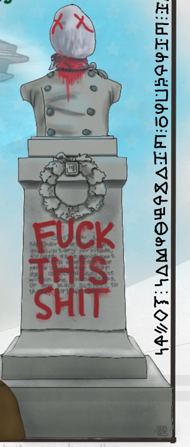

**Written:** Section 1 of the Thirteenth Amendment, verbatim, in tiny handwriting on the pedestal under the
bust: "Neither slavery nor involuntary servitude, except as a punishment for crime whereof the party shall
have been duly convicted, shall exist within the United States, or any place subject to their
jurisdiction." Over it, FUCK THIS SHIT in red.

**What the record reads:** two underlines, under the **1** of "Section 1" and under the word **subject**:
**subject @ 1**, the one pin that is a written word with a written number. Inside "involuntary" the letters
L-U-N are tall block capitals in an otherwise cursive word, the only mid-word case change in about 221
words of the author's handwriting; its meaning is unknown. The red graffiti, the X eyes and the wreath are
properties of the painting the bust copies ([clue 5](#5-the-hooded-bust)), not the author's marks.

**Tried:** subject @ 1 in every shape; slot 1 open with subject anywhere; subject dropped; this or section
@ 1; LUN, lunar, lunch, plunge, luna as words and passphrases (six runs); "section" and the amendment's
line numbers as slot counts; FUCK THIS SHIT, SHT and "fuck this shit" as passphrases.

### 5. The hooded bust

**What it is:** a monument whose head is a white sack with red X eyes, a red rag at the neck, a
double-breasted coat, a wreath with a medallion, and a blanked name band. It copies a 2020 painting of a
defaced Confederate monument in New Orleans; the hood, the X eyes, the rag and the three-line graffiti are
all in the source. The author's own changes: the name band is blank, the inscription is replaced by the
amendment text, the three strokes on the medallion, and the word **BREATHE** on the neck band.

**Tried:** BREATHE and "I can't breathe" as passphrases and extensions in every shape (it is not a BIP39
word); breeze; the bust's XX as 20 and the hood's name. Reading the XX eyes as a number was
withdrawn once the source painting was found.

### 6. The Space Needle: FOOD

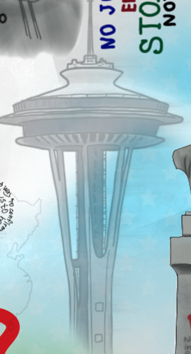

**Written:** the word **FOOD** down the tower's shaft, in the same tiny graphite hand as MOON and TOWER. It
is a pure addition to the photograph the drawing copies, which makes it the positive control for the label
hunts: a method that cannot find FOOD cannot be trusted to find a label we have not seen.

**What the record reads:** FOOD is a device word with no slot. Its ink centroid sits at dial position 4.7
(between 4 and 5), not on the seal's 5|6 line, so "the Needle marks 11" is not supported. The two small
outlined squares on one leg are unresolved (plausibly elevator cars). A column of dashes in the core was
tested as Morse: the dash lengths are a continuum and the decode is gibberish.

**Tried:** food required anywhere in every tight shape; food @ 3 with tower loose; food replaced by any
word; food as passphrase; space, need, tower, eye (the restaurant was once called "Eye of the Needle")
as words and needle as a passphrase.

### 7. The Statue of Liberty

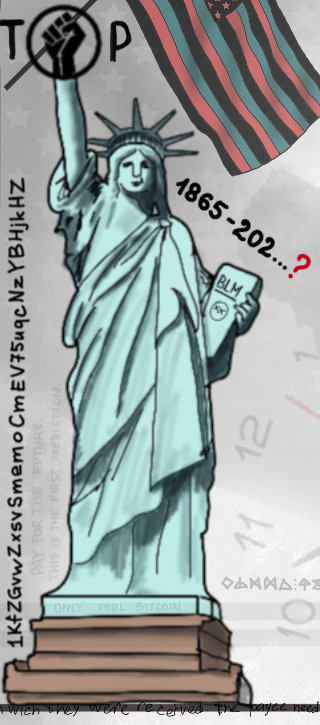


**Written:** on the tablet, BLM, a circled XX and a faint SHT in place of JULY IV MDCCLXXVI; beside the
crown, "1865-202...?" in red; on the base, "ONLY real BITCOIN" with **real** in lowercase. The torch is
gone and the raised hand ends at the black fist that is the O of STOP.

**What the record reads:** **real** is a device word (the only lowercase word in that line). 1865 is the
year of the Thirteenth Amendment and of the statue's conception; the open "202...?" is an unfinished date.
The circled XX most likely means 2020. Seven rays on the crown is a stock feature of the statue, so
"liberty @ 7" is a count reading, not a device.

**Tried:** real required anywhere in every tight shape and replaced; liberty, torch, future, pay, predict,
first as words, statue and crown as passphrases; BLM, XX, 20, twenty, 2020, 1865, "1865-2020", 18652020, SHT, "july iv
mdcclxxvi", 1776 and their casings as passphrases.

### 8. The flag and the fist


**What it is:** a US flag with **44** red stars on a black canton and 13 stripes in black, red and teal
(the Pan-African colours), on a pole held by the statue; the word STOP with a raised black fist as its O.
We counted the stars three times; 44 is exact and looks chosen.

**What the record reads:** 44 supports the BIP44 derivation path, as the community has said since 2023.
13 stripes have been read as "a 13th word, the passphrase". Neither names a word.

**Tried:** BIP44 paths in every run; the account and index sweeps on the tight shapes; punch, power, black,
flag as words, stop and star as passphrases and Electrum words; "13 stripes" readings as model P.

### 9. Trump, Biden, ".VS." and the cipher row

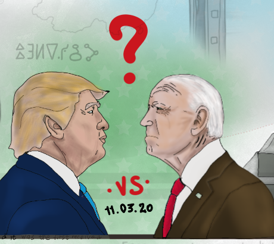

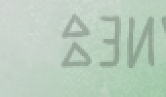

**Written:** the two profiles facing each other with a red question mark between them; ".VS." under them
and "11.03.20", the date of the 2020 election; a short row of Bill Cipher glyphs above the left profile.

**What the record reads:** ".VS." read upside down is **12**, which is how the community put **vote @ 12**;
we keep it as a weak pin and release slot 12 in most two-unknown searches. The glyph row reads **TUESDAY**
under the public Bill Cipher chart, 7 of 7 glyphs (the election fell on a Tuesday); an earlier reading of
TUESVAP misread two glyphs. It does not fit the author's own Cyrillic key, and it names no slot.

**Tried:** vote @ 12 pinned and released; debate, swap, switch, exchange, change, flip, trade, blue, twelve,
second, party, enemy, match, oppose at 12; tuesday, вторник, 11032020, 11.03.20, 110320, biden, trump,
байден, трамп and 38 Tuesday and election-date strings as passphrases.

### 10. The masked crowd, the face boxes and the cameras

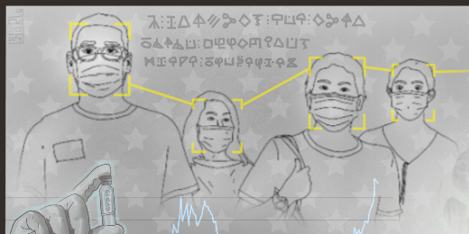

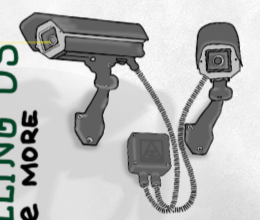

**What it is:** four masked people at the top left, three of them in yellow face-detection brackets joined
by one polyline that ends at the lens of the first of two CCTV cameras at the top right. The cameras' box
carries a stock warning icon. A yellow cursive line across the top reads "Order and stability", the only
yellow text in the picture.


**What the record reads:** **order** is a device word (the only yellow text; it is also a stock Russian
political slogan, so medium confidence). The community's camera @ 2 and mask @ 4 are counts of objects,
not devices.

**Tried:** order required anywhere and replaced; camera, mask, police, face, crowd, twin, security, watch,
video, box, bracket, focus, identify, target as words; "order and stability", "порядок и стабильность",
"new world order", "nwo" as passphrases. "Order" also appears as the last word of the
whitepaper micro-text before it is cut off ([clue 15](#15-the-title-and-the-header)).

### 11. The gold chart, the gloved hand and the sign


**What it is:** a line chart with a y-axis from 200 to 1,800; a gloved hand holding a vial marked CVD19; a
small sign reading "COVID 19 IS A HOAX 5G IS THE KILLER" (a 2020 graffiti).

**What the record reads:** the chart is a faithful trace of the gold price from mid-2003 to mid-2020,
monthly, with no deliberate deviation; 17 years is where the community's "gold @ 17" comes from. The vial
and the sign write 19 twice, the firmest number past 13 in the picture, with no written word beside it.
"1713" read in the COVID area is "19 IS" misread.

**Tried:** gold, price, axis, maximum, glove, hand, virus, disease, phone, mobile as words; covid, cvd19 and
hoax as passphrases; the chart's values as indices.

### 12. George Floyd and the slogans


**Written:** "05.25.20" and "I can't BREATHE" on the hoodie; beside it, in four colours, BLACK LIVES MATTER,
NO JUSTICE NO PEACE, END POLICE BRUTALITY, STOP KILLING US, NOT one MORE.

**What the record reads:** **one** is a device word (lowercase in a block of capitals). "END POLICE
BRUTALITY" is line 5 of the block when BLACK, LIVES and MATTER are lines 1 to 3, which is the community's
police @ 5: a count, not a device, and in conflict with the device pins. The date fixes the picture's
drawing after the funding.

**Tried:** one required anywhere and replaced; black, life, police, peace, security, matter as words,
justice and kill as passphrases; breathe, 05252020, 05.25.20, 052520, blm, "blm xx" as passphrases.

### 13. The maps and the rifle

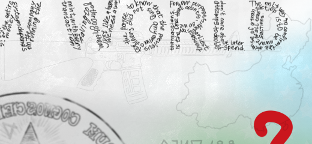

**What it is:** faint outline maps of China and the United States, and a faint AR-15 pattern rifle drawn
behind NEW WORLD with no stamped text. The community read it as an M16 aimed at a factory in China
(rifle @ 16, from the model number); the drawing carries no 16.

**Tried:** rifle, gun, weapon, trade, deal, country, world as words; war, russia, niger and map as passphrases;
the maps as a shape key (no map behind the faint patches).

### 14. The Bitcoin whitepaper in the letters

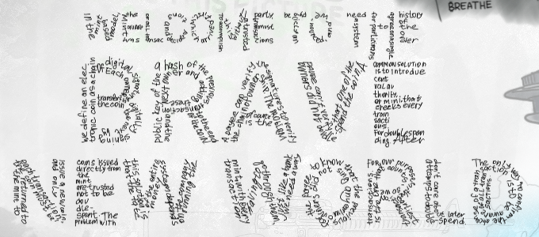

**What it is:** the letters of WELCOME TO THE BRAVE NEW WORLD are hollow and filled with tiny handwriting:
one gap-free copy of section 2 of the Bitcoin whitepaper [14], in the order BRAVE, NEW, WORLD, WELCOME,
TO, THE, then along the bottom border, readable at 5x to 8x
([a 4x render of BRAVE](puzzles/btc-02-picture/artifacts/clock/brave_4x.png)).

**What the record reads:** the copy carries ten edits (introdue, doudle, sing for sign, abcense,
participans, wich, proot, transactian, a deleted "a trusted", and "oder" for "order", the only edit on a
device word). Nine pre-registered extraction rules over the deleted, inserted and substituted letters give
noise, and a control recovered every confirmable edit. It is handwriting, so glyph matching cannot settle
the doubtful letters. The micro-text carries no message that we can find.

**Tried:** sign, sing, proof, first, agree, receive, major, order, trust, party, history, system as words;
"a trusted" and "must be" as passphrases; the edit letters as indices.

### 15. The title and the header

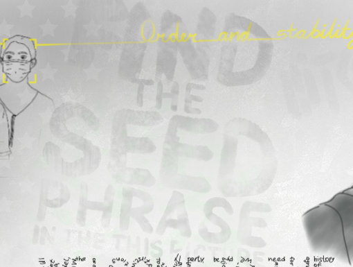

**Written:** in faint paint (about 5 % ink), FIND THE SEED PHRASE IN THE **THIS** PICTURE, with "THIS"
ungrammatical and green-tinted; right of it, a large faint slanted **BITCOIN**. The painted letters are
solid: there is no micro-text inside them.

**What the record reads:** **this** is a device word (the odd word out, tinted). BITCOIN is marked but not
a BIP39 word.

**Tried:** this required anywhere, replaced, and at slot 1; bitcoin, BITCOIN, Bitcoin, "brave new world",
"welcome to the brave new world" as passphrases and extensions; find, seed, phrase, picture, welcome, brave,
world, paper as words.

### 16. The bottom border


**Written:** the whitepaper copy continues along the bottom in blue ("in wich they were received, the payee
needs proot that at the time of each transaction, the majority of nodes agreed it was the first received")
and is cut right after "order"; two words are overpainted in a second colour with one switch mid-word, a
band effect and not a word device. Below it, in grey: "Esse quam niger es, sic dixit caccabus ollae", a
Latin rendering of "the pot calling the kettle black".

**What the record reads:** **black** again (niger), which with "чёрный день" makes black the best-supported
word with a number ([clue 1](#1-the-borders-the-address-and-the-rune-cipher)).

**Tried:** black in every role; niger, "esse quam niger es" and the proverb's forms as passphrases; fire,
accuse, verb as words and pot as a passphrase.

### 17. The signature


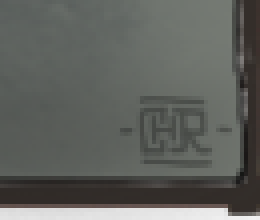

**What it is:** "CHaRLy", small, underlined and turned 90 degrees in the top-left corner, with the C and H
joined; a "-CHR-" monogram stamp in the bottom-right corner with the same joined C-H. Together they are the
author's signature. They identify nobody we could verify, and we do not profile or contact people.

**Tried:** CHARLEY, Charley, charley, CHaRLy, Charly, CHR, -CHR-, Charles, Чарли as passphrases and
extensions.

## The pins, slot by slot

The reading the record stands on, as of 2026-10-21. Grades: **A** a written word with a written or measured
number; **B** a measured position with the word as the object's name; **W** a count or theme reading (the
community's table [8]); none, no device at that number. Slots 1 to 13 are the ones the searches pin; 14 to
24 are what a 24-word reading would need and mostly have nothing.

| Slot | Word | Grade | The device | What else the same device could mean |
|---|---|---|---|---|
| 1 | subject | A | the underlined 1 of "Section 1" and the underlined "subject" on the pedestal | this or section at 1 (tried) |
| 2 | camera | W | two cameras | security, watch, video; the box makes three |
| 3 | tower | A | TOWER written along the minute hand, on 1 and 2 | |
| 4 | mask | W | four masked people | face, crowd; four is also the yellow boxes |
| 5 | police | W | END POLICE BRUTALITY is line 5 of the slogan block | by the same count black is line 1, stop line 6, one line 7 |
| 6 | none | | a dial numeral under the seal | a free slot |
| 7 | liberty | W | seven rays on the crown, a stock feature | |
| 8 | none | | an exposed dial numeral | a free slot |
| 9 | eye | B | the capstone eye on the 4 and 5 midpoint | the word is the object's name |
| 10 | black | A- | "number" plus Nauthiz (rune 10) plus "black day"; the Latin "niger" | the rune as N or X; black has also run free and absent |
| 11 | pyramid | B | the seal's centre on the 5 and 6 midpoint | as slot 9 |
| 12 | vote | W | ".VS." read as a 12; 11.03.20 is a vote | reads 21 mirrored; swap, debate, blue ran at 12 |
| 13 | moon | A | MOON along the red second hand on 12 and 1, its tail on 6 and 7 | the strongest pin: Electrum's word 13 or the passphrase |
| 14, 15 | none | | nothing in the picture writes 14 or 15 | |
| 16 | rifle | W | the rifle's model number, supplied by the viewer | gun, weapon |
| 17 | gold | W | the chart spans 17 years by a fit; no 17 is written | |
| 18 | none | | 1800 on the axis, 1865 on the tablet, the novel's 18 chapters: no marked word | |
| 19 | glove | W | CVD19 on the vial and COVID 19 on the sign | the number labels the vial; glove is the community's choice |
| 20 | second | W | the circled XX on the tablet (the bust's XX eyes are the source painting's) | twenty, year; XX / 20 / 2020 ran as passphrases |
| 21 | (none) | B | the unlabelled hour hand on 10 and 11; the red dotted line has 21 dots | a length (21 words, tried), a slot with no word, or 21 million |
| 22 to 24 | none | | nothing writes 22, 23 or 24; the 44 stars are a count | |

Six slots at grade A or B, five device words with no slot (food, this, real, one, order), eight slots with
no device at all. That is why the searches live in the 12-word and 13-word shapes: a 24-word phrase from
this picture has at least 13 unknown words, and 2,048 to the 13th is not a search.

## What we've tried, at a glance

Condensed from TESTED.md and the configs so you can see what is covered before you spend compute. It is cut
at **2026-10-02 07:12** and counts only searches that finished NO MATCH by then; a NO MATCH covers only its own
family of candidates, never more. Names like E3, E4, p6 and p7e are the named searches defined in
TESTED.md. Everything else is in the repository: pull it, the configs are in
`puzzles/btc-02-picture/harness/templates/`.

### Positions: what the art pins, and what we tried at each slot

<!-- words:start -->
| Slot | The art's pin | Other words tried at this slot (most-used first, not complete) | Opened over the whole 2048-word list? |
|---|---|---|---|
| 1 | `subject` | `moon` · `this` · `tower` · `vote` · `pyramid` · `section` · `base` · `model` · `food` · `ubi` · `lunar` · `lunch` | yes, one slot at a time, in all three models; `subject` dropped in E13 and E12. Not in model P, not at two unknowns |
| 2, 4 to 8 | none (free) | `camera` · `mask` · `police` · `liberty` · `hand` · `rifle` · `twin` · `face` · `head` | yes: one at a time in every tight shape, in pairs in E3, E4, p6e, p7e, p6 and p7; never three at once |
| 3 | `tower` | `eye` · `minute` · `food` · `black` · `pyramid` · `clock` · `all` · `order` · `vote` · `ibi` | `tower` dropped in E13 and E12 (and `food` at 3 with `tower` loose). Not in model P |
| 9 | `eye` | `know` · `learn` · `tower` · `discover` · `pyramid` · `where` · `sight` · `witness` · `glory` · `provide` · `protect` · `trade` · `two` · `top` · `view` · `spy` · `observe` · `monitor` · `guard` · `light` · `shine` | one slot at a time with the other kept (Electrum two unknowns; model P as one-unknown tiles). **Never 9 and 11 together** |
| 10 | `black` | `day` · `twenty` · `fortune` · `wheel` · `one` · `need` · `pyramid` · `abuse` · `access` · `number` · `rain` · `ten` · `tower` · `eye` · `system` · `food` | `black` free (E4, p7e); in model P `black`@10 and the seven slices of p7; `black` absent in all three models |
| 11 | `pyramid` | `world` · `just` · `peace` · `one` · `vote` · `build` · `step` · `level` · `know` · `cause` · `good` · `home` · `country` · `moon` · `there` · `food` · `stamp` · `circle` · `coin` · `brick` · `stone` | as slot 9. **Never 9 and 11 together** |
| 12 | `vote` | `moon` · `swap` · `switch` · `exchange` · `change` · `flip` · `trade` · `debate` · `blue` · `twelve` · `second` · `accident` · `account` · `black` · `subject` · `pyramid` · `enemy` · `face` · `match` · `oppose` · `party` | released to any word in E3, E4, p6, p6e, p7 and p7e |
| 13 | `moon` (Electrum-13's 13th word) | `subject` · `month` · `second` · `pyramid` · `world` · `plunge`, and the fifteen generator words `ability` to `acid` | slot 13 over the whole list in Electrum-13. Never the passphrase over a whole list |

### The words, by how much of the search is built on them

| Tier | Words | How they were used |
|---|---|---|
| 1: the core | `tower` · `subject` · `black` · `food` · `real` · `order` · `this` · `one` · `eye` · `pyramid` · `vote` · `moon` | pinned to a slot or required in the largest share of the searches |
| 2: the marked tokens | `breathe` · `bitcoin` · `blm` · `tuesday` · `lun` · `stop` · `freedom` · `white` · `death` · `kill` · `money` · `war` · `hate` · `trusted` · `slave` · `slavery` · `niger` · `russia` | each pinned, one at a time, at every slot from 1 to 13 (raw-text and Electrum-native searches) |
| 2: other widely tried words | `ten` · `world` · `know` · `second` · `day` · `camera` · `just` · `peace` · `mask` · `country` · `glory` · `home` · `good` · `gold` · `cause` · `liberty` · `police` · `face` · `rifle` · `time` · `two` · `party` · `hand` | placed in many different searches |

Everything else (single leads and one-off pools) is in the configs. The whole 2048-word list was opened at one or two slots in most searches.

### Passphrases and extensions tried

| Group | Strings (casing variants were tried for most) |
|---|---|
| the moon casings | `moon` · `MOON` · `Moon`: the largest share of the searches (Electrum folds them into one extension) |
| breathe | `breathe` |
| numbers and dates | `2020` · `20` · `xx` · `xxi` · `twenty` · `twenty one` · `21` · `2021` · `1865` · `1865-2020` · `18652020` · `1865-2021` · `1776` · `mdcclxxvi` · `july iv mdcclxxvi` · `05252020` · `05.25.20` · `052520` · `11032020` · `11.03.20` · `110320` · `21000000` · `1628` · `xxxx` · `moon2020` · `двадцать` · `двадцать один` |
| tuesday | `tuesday` · `вторник` |
| blm | `blm` · `blm xx` · `blmxx` · `blm 2020` |
| words and names | `bitcoin` · `russia` · `niger` · `lun` · `plunge` · `miranda` · `rosalind` · `biden` · `trump` · `байден` · `трамп` · `bill cipher` · `gravity falls` · `blood moon` · `mundus` |
| single words | `food` · `this` · `subject` · `world` · `month` · `needle` · `space` · `death` · `des` · `еда` |
| phrases | `brave new world` · `welcome to the brave new world` · `new world order` · `novus ordo seclorum` · `nwo` · `order and stability` · `порядок и стабильность` · `fuck this shit` · `sht` |
| bulk lists | the 1,318-string tier-0 list (BIP39, Electrum and raw text) and the 818 further tier-1 strings (BIP39 and Electrum; raw tier 1 was not run) |
<!-- words:end -->

### Families of search, and what is NOT covered

| Family | What was tried | NOT covered |
|---|---|---|
| One unknown word (the "tight" shapes) | all three models; `black` free, `vote` pinned or freed, `moon`@1, a lower or upper numeral, `eye` as word 13 or as passphrase or free, `peace`@11, `this` or `section`@1 | a second unknown word; any pin wrong |
| Two unknown words (E3, E4, p6, p6e, p7, p7e) | subject@1 tower@3 eye@9 pyramid@11 held, food, this, real, one, order present, **any** two other words over the whole list, empty passphrase (plus MOON, moon, Moon in P and "moon" in E12) | any pin wrong; three or more unknowns (about 29 h per word in E13, 170 days for three in P) |
| Slots 9 and 11 | object-name pairs, themed and meme pairs, the Bush-speech pool (Electrum only), Latin-motto words, the dial strip's words; either slot over the whole list | both over the whole list (three unknowns: about 26 h in E13, 2 days in E12, 2 months in P) |
| Leave one out, and drops | each of food, this, real, one, order replaced by any word plus one more; one of eye, pyramid, black, tower, subject dropped and replaced (E13 and E12; in P `black`, and 9 or 11 one at a time) | two wrong words at once; model-P drops of subject, tower and the floaters at 9 and 11 |
| Moon readings | moon@1 (mod 12), @2, @12 with vote@13, moon an ordinary word; lunar, lunch, plunge, LUN at 13; month, second, hour, world and more | other spellings; non-English moon words beyond луна, месяц, lundi |
| Passphrases and extensions | the table above, the 1,318 and 818 string lists, 55 date forms | strings nobody listed; the date extensions at two unknowns in E12 (interrupted at 379 of 630 blocks); the same strings at two unknowns in P (about 84.6 billion) |
| Positions | slot 1 open with subject anywhere; subject@13; food@3 with tower loose; vote@2 or 11; swap words at 12; count pins; the mirrored dial and reversed pins | the two-unknown forms of the dial, the pins and slot 1; this@1 at two unknowns in P |
| Other lengths and tables | the 18-word and 21-word community tables, rarsn4's variants (CPU) | raw 21 or 24-word seeds (about 17 unknowns); BIP39-15 with the pins (about 170 days) |
| Derivation paths | BIP39 `m/44'/0'/0'/0/{0,1,10}`, `m/0'/0/0`, `m/0/0`; Electrum `m/0/{0,1,2}`, `m/1/0`; many more receive, change and account indices on the tight shapes | E4, p7e and p6 at 40 paths (about 3.5 h each in Electrum, about a day in P) |
| Raw text (no checksum) | the tight tiers; the twelve device words in every order; conventions; pin pairs; the clock triple and quad; tokens in the phrase | the whole-list raw two-unknown tiers; raw tier 1 |
| Community sets and rules | the void-CUDA set; date-index words; a sum-60 rule; the WELCOME matrix; May and June 12! sweeps | unfinished June runs; every thematic set nobody listed |

Not searched at all: address types other than legacy P2PKH, any wordlist other than BIP39 (and Electrum's `01` seeds), derivation
paths and passphrases outside the lists above. The full tables, with every family's exclusions, are in [TESTED.md](TESTED.md).

## Since the published record

The ledger in this repository ends at **2026-10-02 07:12**. The search went on for three more weeks; what
follows is a dated summary of it, from the private record, so that nobody repeats it. None of these runs
is in `ledger/runs.jsonl` yet, and their configs are not in `harness/templates/` here; since the cutoff
the private ledger counts 983 finished runs and 3.33 x 10¹² candidates on the home cards to 2026-10-21,
every one NO MATCH, with the rented tiles and rows below logged apart from it. A later export will
carry them.

| When | What was tried |
|---|---|
| 2026-10-03 to 06 | The held rows of the second lead hunt (124 configs), swapped-tier and count-pin forms, two word matrices posted on the forum (12 configs), fifteen every-order readings of the core words, a forum member's own slot reading (5 configs), a 42-config queue of the remaining drafts |
| 2026-10-07 | The Elder Futhark route: the other border glyphs read as rune names (17 configs, 4.06 billion candidates); 18 model-P triples; an overnight block of 24 |
| 2026-10-08 to 09 | Eight batches of words proposed by fresh readings of the picture (uw1 to uw8: 37 configs, 53 billion candidates); the faint BITCOIN behind the title recovered and tested as a passphrase (5 configs) |
| 2026-10-09 | **Every clock reading we could define:** 2,816 readings of the three hands, 280 placements, 840 configs; the clock is closed as a reading |
| 2026-10-09 to 10 | The widest shapes (two unknowns with weak pins) cut into 6-hour tiles for rented cards: 53 tiles on two Lightning L4 studios |
| 2026-10-15 to 17 | Word associations from the 66 clues against random-noun controls: not selective (2.71 words per clue against 3.11 for random nouns); no new rule |
| 2026-10-16 | Image forensics on the file: noise and chroma maps (the grey ground carries a texture overlay; pasted pieces show in chroma), resampling (only the statue was resized, by about 1.33), copy-move (no repeats beyond the known ones), opacity (the seal is opaque), a learned forgery detector (fires on everything, no claim), OCR at three sizes (nothing below 8 px x-height). Steganalysis repeated: no metadata, no trailing bytes, LSB planes are paper grain; nothing new |
| 2026-10-16 | Solved-puzzle conventions (11 conventions, 318,304 derivations); key forms other than a BIP39 seed over the 720 orders of the device words: brainwallets, a BIP32 master node from the raw words, PBKDF2 seed halves, entropy forms, WarpWallet; controls found |
| 2026-10-16 | BIP39 at 15 words with the 13 device words and two unknowns, at a web tool's default path (8 configs) |
| 2026-10-17 | An object inventory by hand (27 objects, 458 readings) and by four detectors over 52 views (no drawn object the register missed; planted control found); two local vision-language readers over 1,003 crops (56 of 63 known words re-read, nothing new); the 29 cheapest no-checksum twins on the CPU; nothing new |
| 2026-10-17 to 19 | Every GPU family ranked by evidence into one registry and cut into an order; 260 rows run on two rented 4 x RTX 4090 boxes; 51 more at home |
| 2026-10-20 | A format-coverage pass (one row of each shape the ranking had not reached); phrases keyed on the address's own characters (59, from a pasted outside analysis); the clock read as a compass (chance-level city hits); nothing new |
| 2026-10-21 | The "misdirection" closures: the picture's numbers as pair sums (966), Fibonacci and hand-sum strings (54), the address itself as the passphrase, coin types 13' and 44', 38 Tuesday and election-date strings, 26,239 brainwallet strings, the picture's numbers as a key; one-unknown and two-unknown forms of the above on the GPU; a forum member's pooled Electrum phrases at 15, 19 and 20 words; controls found |
| 2026-10-21 | A Trezor reading: 24 words with every pin above 13 from the community table and the open slots from the 66 depicted words (10 rows); 24 words closed as a reading, not as a search |
| 2026-10-21 | Two bounded image mechanisms: a flag-star lattice fitted to the 44 stars (zero vacancies, a planted removal found) and the red dotted line read as Morse (no stable mark/gap split); the Bill Cipher row re-read (TUESDAY, 7 of 7); no new rule |
| 2026-10-21 | "One picture, two words": each device word paired with its picture's second word, 24 words, four pairing rules (619,170 valid phrases on the CPU); controls found |

## Readings we withdrew

The record keeps its corrections. These are the readings that were believed at some point, by us or by
the community, and that a measurement later overturned.

| It was read as | What the measurement says |
|---|---|
| The clock shows 10:07 | Not a time: every hand sits on a numeral midpoint and the hour hand is nearly ten degrees off any real time (2026-05-31, re-measured 09-22) |
| The micro-text is below readable resolution | Readable at 5x to 8x, fully transcribed, and handwriting (2026-09-28; test 5, 2026-10-16) |
| The seal is semi-transparent, hiding something | Opaque: a flat-fill slope on three patches (test 6) |
| The number glyph is a clean X | The rune Nauthiz, a full-height stave crossed by one diagonal; still read as 10 (2026-09-30) |
| The Bill Cipher row reads TUESVAP | TUESDAY, 7 of 7 glyphs under the public chart (2026-10-21) |
| The Space Needle marks 11 with the clock | FOOD's ink sits between 4 and 5, not on the seal's 5 and 6 line |
| The bust's X eyes and FUCK THIS SHIT are the author's marks | Properties of the 2020 painting the bust copies (2026-10-01) |
| The funder's wallet is a different wallet from the prize | Withdrawn: one HD seed can hold both accounts (2026-09-30) |
| "1713" in the COVID area, so STOCK | "19 IS" misread |
| Eleven whitepaper edits, "must be" deleted | Ten: "must be" is present in the N of NEW (2026-10-21) |
| An Atlanta painter signed it | The cited Instagram post is a portrait with a leaf, not the collage; no 9/11, Great Seal or Illuminati work in the catalogue (2026-10-07) |
| Any word that fits the theme is a candidate | The funding predates the scenes; thematic words carry no selective weight against random-noun controls (2026-09-22, 2026-10-17) |

## The GPU engine

Everything above was turned into searches by one engine, `puzzles/btc-02-picture/harness/gpu_setperm.py`,
written for this puzzle in late September 2026 and reviewed, audited and mutation-tested since. It reads a
small text config, enumerates a candidate space on the GPU, derives every survivor to an address and
compares. It never builds a transaction and has no network access (`docs/ADR-0001.md`).

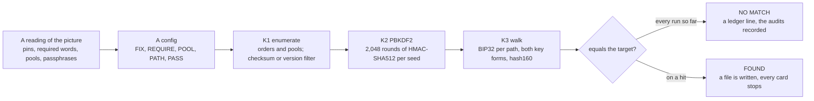

A config looks like this (the two-unknown model-P search `p6`):

```
SCHEME bip39
WORDS 12
FIX 1 subject
FIX 3 tower
FIX 9 eye
FIX 10 black
FIX 11 pyramid
REQUIRE food this real one order
POOL @WORDLIST
PATH m/44'/0'/0'/0/0
PATH m/44'/0'/0'/0/1
PATH m/44'/0'/0'/0/10
PATH m/0'/0/0
PATH m/0/0
PASS MOON
PASS moon
PASS Moon
```

`FIX` pins a word to a slot, `REQUIRE` forces words to appear somewhere, `POOL` fills the open slots (here
the whole 2,048-word list, twice, in order), every `PATH` is walked for every survivor, and every `PASS`
plus the empty passphrase is derived. That config is 7!/2! x 2,048² = 10.6 billion candidates, 660 million
after the checksum, each derived at four passphrases, five paths and two key forms.

### What it measures to

All on the home card, an RTX 5060 Ti (36 SMs). Stage rates are from the 2026-09-28 bench of each kernel
against hashlib and the CPU reference; pipeline rates are medians over the 1,735 run logs with at least 60
heartbeats (the report is `reports/ENGINE-CEILING-2026-10-21.md` in the private tree; the kernels and the
harness README are here).

| Stage | Rate |
|---|---|
| K1: permutation and pool enumeration plus the BIP39 checksum | 3.75 G candidates/s |
| Electrum version filter | 687 M/s |
| K2: PBKDF2-HMAC-SHA512, 2,048 rounds, register-resident (`kernels/sp_pbkdf2.cl` with `sp_sha512.cl`) | **426k seeds/s** |
| the upstream byte-array PBKDF2 it replaced | 149.5k seeds/s |
| K3: the BIP44 walk `m/44'/0'/0'/0/0` plus P2PKH | 2.36 M derivations/s |
| one fixed-base secp256k1 multiplication plus serialise | 10.05 M/s |

| Whole pipeline (enumeration, PBKDF2, the walk over every path in both key forms, the compare, the audits) | derivations/s |
|---|---|
| BIP39, 12 words, 1 path | 381k |
| BIP39, 12 words, 5 paths | 269k |
| BIP39, 24 words, 1 path | 306k |
| Electrum, 12 words, 1 / 4 / 8 paths | 341k / 285k / 260k |
| Electrum, 13 words, 4 paths | 255k |

**Against the field.** hashcat v7.0.0 on an RTX 5070 (48 SMs, the same generation) does PBKDF2-SHA512 at
1,023 iterations at 1,212.9 kH/s [13]; scaled by SM count to this card and to BIP39's 2,048 iterations that
is about 455k seeds/s. K2's 426k is **about 94 % of hashcat class**. A CUDA port of the same kernel agrees
within 1 %, and halving its register budget changes nothing: one SHA-512 compression compiles to about 3,460
instructions, 3,384 of them integer arithmetic, so the kernel is bound by instruction issue, not latency.
The gap between 426k and the pipeline's 269k on five paths is the paths, not the hashing.

**What a purpose-built engine would buy.** Modelled with PBKDF2 at hashcat class and the walk and pipeline
halved: 1.12x on one-path configs, 1.29x on five-path configs; with a 50k to 100k CPU lane beside the card,
1.25x to 1.66x. Not 2x. The held families that cost hundreds of hours stay hundreds of hours, so the lever is
which reading to run, not how fast. We left the engine as it is.

### Why a NO MATCH can be trusted

- **Known-answer tests** on every kernel against hashlib and a CPU reference that shares no code with it:
  the BIP39 test vectors, 12 to 24 words, passphrases, the long-key path, lengths around the 128-byte
  boundary. `gpu_setperm_test.py` runs 383 tests (115 need a GPU).
- **Every block carries 64 planted seeds** that must be found at their exact place (one per block in the
  first run, E4), and the prize is compared at two target slots, so a fault confined to one slot cannot lose
  it. A fault that loses a fraction q of hits escapes a block's plants with probability (1 - q) to the 64th.
- **Exact accounting:** a 64-bit index sum per launch and per block, `tested == scanned`, a binomial check
  on the survivor count (a block beyond 8 sigma is VOID; the observed |z| stayed below 4), a per-block window
  audit that re-derives a random window on the CPU, and parity tests against `setperm_solve.py`.
- **Independent agent reviews** (`puzzles/btc-02-picture/lanes/`): the review of 29 September injected ten
  faults, nine ended VOID and the one that passed led to the 64-plant design; the audit of 1 October found no
  defect that could cause a missed answer (an independent decoder agreed on all 461 configs, 0 mismatches in
  33,804 derivations); the raw-scheme review checked 1.11 million code points through Electrum's own parser
  and killed 45 of 49 mutants, the four survivors unreachable.
- **A ledger reconciliation** (`harness/ledger_recon.py`) matches every run to an unchanged config on disk
  and every checkpoint's counts to the ledger.
- **What it does not prove:** TESTED.md says what a NO MATCH does not exclude. It is sampled evidence, not
  proof, and it covers only its own config's family.

### Running it

The CPU-only checks need Python 3 and nothing else:

    python3 tools/check_target.py       # the target decodes to HASH160 ccbd031e…
    python3 tools/tally.py              # must equal expected_output/tally.txt
    python3 tools/tally.py --windows    # the windows table of TESTED.md
    sha256sum -c MANIFEST.sha256

The engine needs three Python packages and 14 third-party OpenCL kernels. The kernels are **not** in this
repository (their upstream, johncantrell97/bip39-solver-gpu [15], has no licence), so fetch them: pinned to
one commit and checked file by file.

    python3 tools/fetch_kernels.py
    cd puzzles/btc-02-picture/harness
    uv run --no-project --python 3.12 --with coincurve --with numpy --with pyopencl python -c "import gpu_setperm as g; print(g.engine_hash())"   # 9cb088b6d185f485
    SP_NO_GPU=1 uv run --no-project --python 3.12 --with coincurve --with numpy --with pyopencl python gpu_setperm_test.py   # Ran 383 tests ... OK (skipped=115)
    uv run --no-project --python 3.12 --with coincurve --with numpy --with pyopencl python gpu_setperm.py templates/e4_pins_only.conf --dry-run   # prices a search, runs none
    uv run --no-project --python 3.12 --with coincurve --with numpy --with pyopencl python gpu_setperm.py templates/e4_pins_only.conf --bench     # a dummy target and a planted seed: prints the real rate

`9cb088b6d185f485` is the engine this tree holds. The ledger spans three engine eras (`4e905055f3f5fdaf`,
`e9afbdfd40803095` and `9cb088b6d185f485`), and a run never straddles two. The first two engines are not in
this repository, so a run of those eras cannot be reproduced from here.

A real search needs a written sign-off, a deliberate speed bump that is logged with the run:
`gpu_setperm.py CONFIG --checkpoint x.ck --signoff "who approved what, and when"`. The engine only compares
addresses: it never builds, signs or broadcasts a transaction, and on a hit it writes a file and stops.

### The code

| File | What it is |
|---|---|
| `harness/gpu_setperm.py` | the engine: config, enumeration, the three kernels, the audits, checkpoints, the ledger line |
| `harness/sp_space.py`, `sp_k1_enum.py`, `sp_k2_pbkdf2.py`, `sp_k3_derive.py`, `sp_gpu.py`, `sp_ref.py` | the candidate space, the three stages and their CPU references |
| `harness/kernels/sp_enum.cl`, `sp_decode.cl`, `sp_pbkdf2.cl`, `sp_sha512.cl`, `sp_derive.cl` | the project's own OpenCL: enumeration, decoding, the register-resident PBKDF2, SHA-512, the BIP32 walk. They share no line with the fetched kernels (`THIRD-PARTY.md`) |
| `harness/setperm_solve.py` | the CPU reference the GPU is checked against; `template_solve.py`, `gpu_solve.py`, `orderfirst_solve.py` are the earlier solvers of the May to September runs |
| `harness/gpu_setperm_test.py`, `sp_test_*.py`, `kav_independent.py`, `recount_*.py`, `ck_stats.py`, `ledger_recon.py` | the tests, the independent known-answer check, the exact CPU recounts of sampled blocks, the checkpoint statistics, the reconciler |
| `harness/templates/` | every committed config that ran before the cutoff; `passlists/` and `passphrases.txt` the string lists |
| `harness/kernels/UPSTREAM.sha256`, `address_p2pkh.part`, `tools/fetch_kernels.py` | the pins and the one inserted function for the 14 fetched kernels |

## How we work

- **Read-only, by construction.** There is no transaction code in this repository and there will be none.
  The engine compares a hash160 and stops. A candidate key, if one ever appears, is written to a file and
  the work stops until a human decides what to do (`docs/ADR-0001.md`).
- **No sweep without a sign-off.** Every GPU run is priced first (`--dry-run`) and started only on the
  operator's written word, which the ledger line quotes. Rented cards run nothing without a sign-off file on
  the box.
- **One reading per run, and the reading is written down first.** A config states exactly what it assumes;
  the NO MATCH it produces excludes exactly that and nothing wider.
- **Controls before claims.** Image methods are run on planted controls before they are run on the picture;
  a label hunt is measured by its recall on planted labels; a word association is scored against random
  nouns. A negative that fails its control is recorded as a failed method, not as a negative.
- **The record keeps its mistakes.** Corrections are logged next to the readings they overturn, and the
  withdrawn readings above are part of the published record.
- **Puzzle content, not people.** We do not profile, contact or name the author or anyone who might be.

## What's next

As of 21 October 2026 the search is paused: nothing is queued at home or on a rented card. What would
restart it, in the order we rate it:

1. A word from the author, anywhere public.
2. A new device-backed word: a label found with a method whose recall is measured first, or a mark that a
   control shows to be deliberate.
3. A reading that pins a slot above 13, which is what a longer phrase would need.
4. Outside that, the remaining searches are priced and held: they cost hundreds of GPU-hours each and the
   evidence does not rank any of them above the ones that already failed.

If you have one of the first three, open an issue.

## Not published here

Some of the work is kept back, partly because it is the only edge we have left and partly because it is
unfinished. Some of it is available in exchange for comparable work; ask.

- **The open hypotheses and the ranking.** The list of readings still open, the evidence ranking that orders
  the queue, and the order itself (`gpu_priority.py` and its registry in the private tree).
- **The held configs.** Searches written and priced but never run, several thousand of them, including the
  659-config brainstorm of 2026-10-16 and the no-checksum twins.
- **The open places in the picture.** What the reading-rule and misdirection investigations of October left
  under examination.
- **Leads under test**, and the outside analyses sent to us that have not been closed yet.
- **The engine-ceiling prototype**: the CUDA port of the PBKDF2 kernel, the roofline kernels and the timing
  runner. The numbers are above; the code stays private for now.
- **The working log, the session handoffs and the internal reports.** The reviews in `lanes/` cite
  `scratch/...`, `HANDOFF*.md` and other working files of the private tree; those are **not published**
  (`PUBLICATION.md` counts what was done to produce this copy). A few configs that were run from scratch
  directories, the `gd_*` and `wh_x10_*` families, were never committed and are not here either.

## What is here

    TESTED.md                   what was tested, family by family, and what a NO MATCH means
    tools/                      tally.py (the totals), check_target.py, fetch_kernels.py
    expected_output/            what each tool prints, the engine hash, the CPU test result
    docs/ADR-0001.md            the rails: read-only, never a transaction, a candidate key stops everything
    puzzles/btc-02-picture/
        harness/                the GPU engine (gpu_setperm.py, sp_*), its tests, the independent verifiers, the
                                earlier solvers, and the committed configs that were run (templates/)
        ledger/                 the run ledger (runs.jsonl) and the queue logs, which name each config as it finishes
        lanes/                  independent reviews and audits of the engine (agent-written)
        artifacts/              the puzzle image, four small test inputs the code reads, the clock and rune crops
                                and the crops this page shows

Paths in the documents are relative to `puzzles/btc-02-picture/`.

## Prior work

The same puzzle is analysed in [HomelessPhD/BLM_0.2BTC](https://github.com/HomelessPhD/BLM_0.2BTC) [8], whose
page this one is modelled on, and in [rarsn4/blm-0.2btc-analysis](https://github.com/rarsn4/blm-0.2btc-analysis)
[9], whose layout this repository follows and whose rune and clock measurements we reproduced independently.
The community candidate sets of 2020 to 2023 are in the Reddit and bitcointalk threads [2, 3, 4] and on
privatekeys.pw [5].

## Contact

Questions, corrections, or a lead to test: open an issue on this repository.

## Support

If this helped you figure it out and you feel generous:

- **BTC:** `bc1qptzpgk0z33nku9xrh8duay4jgt654uh65cc9rr`
- **ETH:** `0xd2C2408E370293aC7ac116512C1c57071B9FA5B6`

Optional. Everything here is public either way.

## Provenance

A working record kept by the operator together with AI coding agents (Claude). Code is MIT (`LICENSE`); text
and data are CC BY 4.0 (`LICENSE-DATA`); the puzzle image is the artist's, not ours, and the third-party
kernels are fetched, not redistributed (`THIRD-PARTY.md`). `PUBLICATION.md` says, by count, what was done to
the working tree to produce this copy.

## References

1. The post: u/stsh_n, "Bitcoin puzzle (2000$)", 2020-10-08,
   <https://www.reddit.com/user/stsh_n/comments/j79zvj/bitcoin_puzzle_2000/>
2. The r/bitcoinpuzzles repost, <https://www.reddit.com/r/bitcoinpuzzles/comments/jrr7mo/is_this_puzzle_still_valid_is_this_image_correct/>
3. The r/CryptoPuzzlers thread, <https://www.reddit.com/r/CryptoPuzzlers/comments/mbdogq/02_btc_puzzle/>
4. The bitcointalk thread, <https://bitcointalk.org/index.php?topic=5404767.0>
5. privatekeys.pw, <https://privatekeys.pw/puzzles/0.2-btc-puzzle>
6. The address on mempool.space, <https://mempool.space/address/1KfZGvwZxsvSmemoCmEV75uqcNzYBHjkHZ>
7. The funding transaction, <https://mempool.space/tx/fcee21d44ee94c09869947c74b61669bf928358e9c2d1699fb075bb6ebf5d043>
8. HomelessPhD, "0.2 BTC BLM puzzle", <https://github.com/HomelessPhD/BLM_0.2BTC>
9. rarsn4, "blm-0.2btc-analysis", <https://github.com/rarsn4/blm-0.2btc-analysis>
10. panchpasha, "0.2-BTC-Puzzle-script", <https://github.com/panchpasha/0.2-BTC-Puzzle-script>
11. BIP-0039 and BIP-0044, <https://github.com/bitcoin/bips/blob/master/bip-0039.mediawiki>,
    <https://github.com/bitcoin/bips/blob/master/bip-0044.mediawiki>
12. Electrum seed phrases, <https://electrum.readthedocs.io/en/latest/seedphrase.html>
13. hashcat v7.0.0 benchmark on an RTX 5070, forum thread 13327, <https://hashcat.net/forum/thread-13327.html>
14. Satoshi Nakamoto, "Bitcoin: A Peer-to-Peer Electronic Cash System", <https://bitcoin.org/bitcoin.pdf>
15. johncantrell97/bip39-solver-gpu, the 14 fetched kernels, <https://github.com/johncantrell97/bip39-solver-gpu>
16. The Thirteenth Amendment, Section 1, <https://constitution.congress.gov/constitution/amendment-13/>
17. Wikipedia, the Great Seal of the United States (reverse), <https://en.wikipedia.org/wiki/Great_Seal_of_the_United_States>

*Figures and counts are as of 21 October 2026 unless a cutoff is stated. This page does not update itself.*
